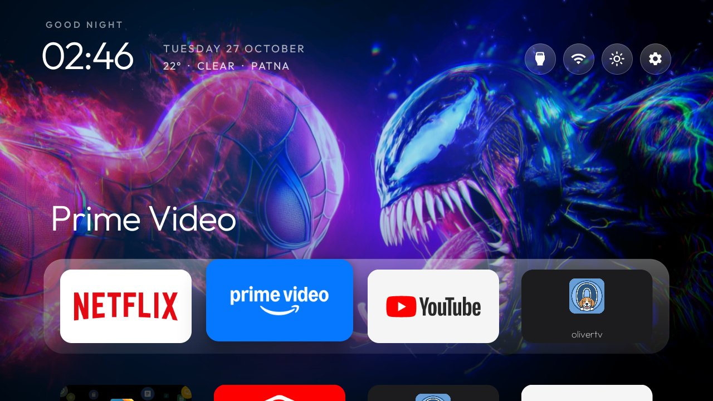
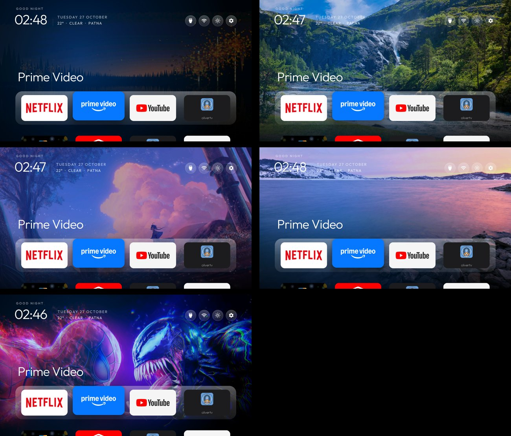
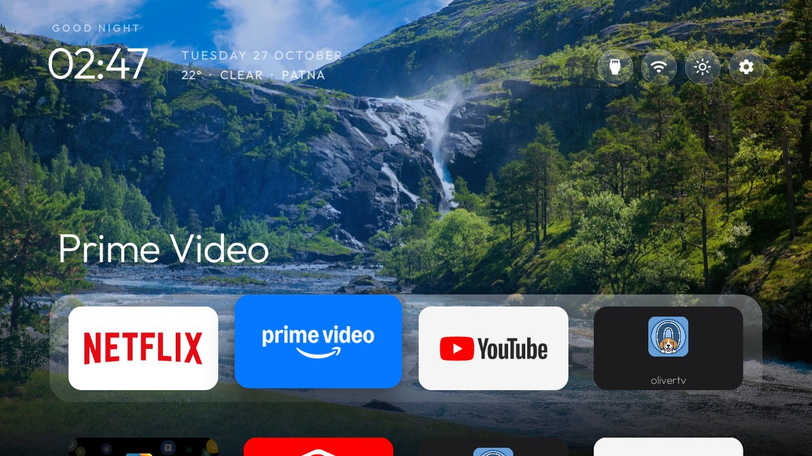
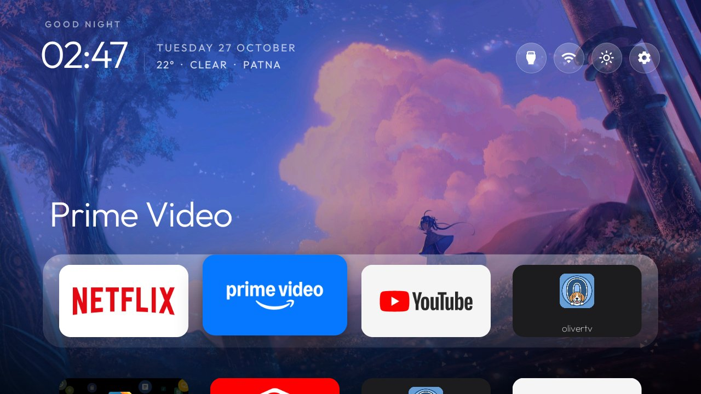
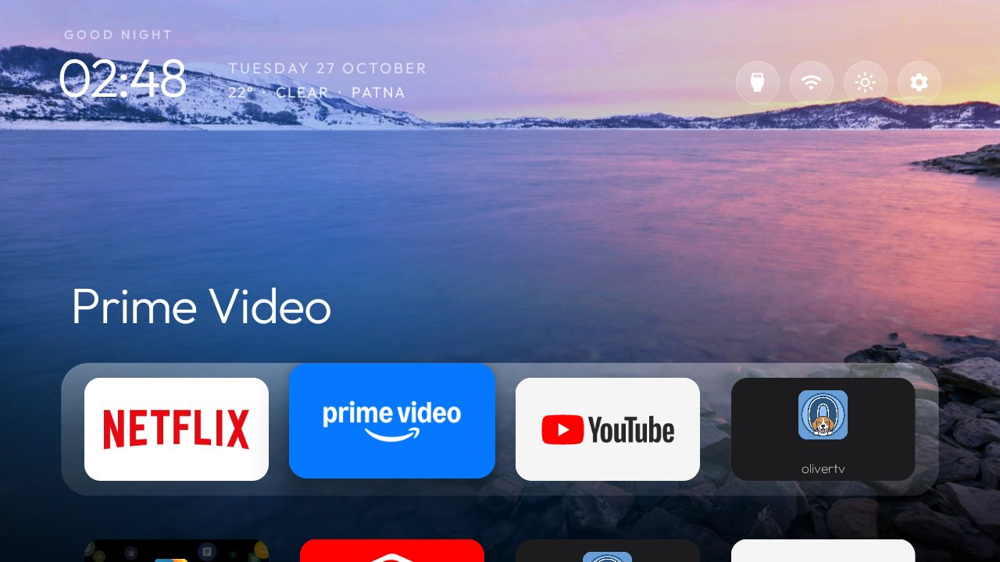
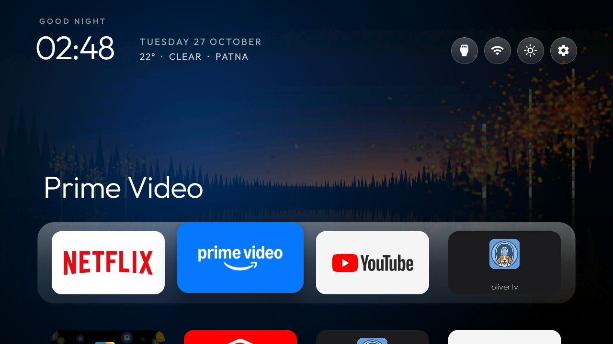
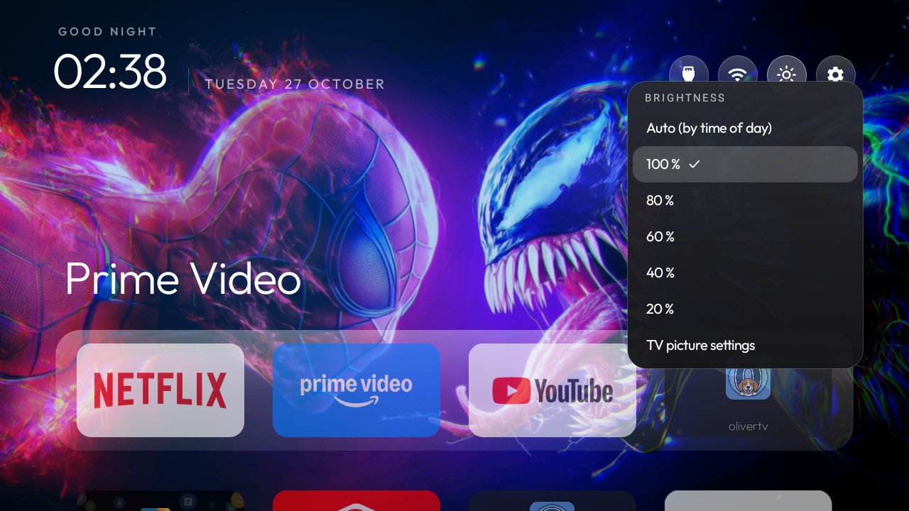

# frag_the_box

The [cleanyourtv](https://github.com/Gathin23/cleanyourtv) home screen for Android TV and Google TV, unchanged
underneath, in my own style. The launcher in `launcher/` is cleanyourtv's (renamed to `com.fragthebox.home`),
so it is just as smooth; the look comes from cleanyourtv's own theme system, in [`themes/frag`](themes/frag).



## Screenshots

Taken on the TV itself (TCL UnionTV, Android TV 9), one per wallpaper in the theme:



| | |
|---|---|
|  |  |
|  |  |
|  | |

## The frag style

| Part | Theme setting |
|---|---|
| Glass dock and a soft glow in the focused app's colour | `dock_glass`, `app_glow`, `ambient_glow` |
| Round icon buttons at the top | `icon_only_buttons`, `icon_only_inputs` |
| Netflix, Prime Video, YouTube, OliverTV in front | `dock_apps` |
| Hold OK on a tile to move it or take it off Home; App library for the rest | `tile_menu`, `app_library` |
| Spider-Man wallpaper by default; the others in Launcher settings → Wallpaper | `wallpaper.jpg` + `wallpapers/` |
| OLED focus: no rim, the focused tile lifts on a deep shadow | `glass_style: lift` (frag addition), `focus_overshoot: false` |
| Apple-style glass dock and top buttons | `dock_glass` (frag: brighter pane, top sheen, light-catching rim) |
| Weather under the date from the Wi-Fi's location ("22° · Clear · Patna") | frag addition (ipwho.is + Open-Meteo, cached 30 min) |
| Dark fade up from the bottom so the apps sit on shadow | frag addition (`bottom_fade`) |
| Brightness button at the top: Auto by time of day, 100–20 %, TV picture settings | frag addition (a dim layer over every app; the TV's real backlight stays in its Picture menu) |

Change the look by editing `themes/frag/config.json` (every key is in cleanyourtv's
[themes README](https://github.com/Gathin23/cleanyourtv/blob/main/themes/README.md)) or the pictures in
`themes/frag/wallpapers/`, then push it again:

```powershell
powershell -ExecutionPolicy Bypass -File tools\theme.ps1 -TvHost <tv ip> themes\frag
```

## Install (Windows)

1. On the TV: **Settings → Device Preferences → About**, press OK on **Build** seven times, then
   **Developer options → USB debugging** on.
2. TV and PC on the same Wi-Fi; note the TV's IP (**Settings → Network**). Install Python 3 if it isn't on the PC.
3. Download this repository, unzip it and double-click **`install.bat`**, type the TV's IP, and press **Allow**
   on the TV.

It installs the launcher from [Releases](https://github.com/Swotboysandy/frag_the_box/releases), makes it Home
and pushes the frag theme. **Undo:** `uninstall.bat`.

## Remove the TV's ads and bloat (optional)

`tools/` and `examples/` are cleanyourtv's debloat tooling and tested TV lists:
`tools\disable.ps1 -TvHost <ip> examples\<your-tv>\debloat.txt`. Everything is disabled, never uninstalled;
`tools\restore.ps1` with the same list undoes it.

## Credits

Launcher, tools and TV lists: [cleanyourtv](https://github.com/Gathin23/cleanyourtv) by Gathin (MIT, see
`LICENSE`). Wallpaper credits: [`themes/frag/CREDITS.md`](themes/frag/CREDITS.md). Outfit font: SIL Open Font
License (`launcher/FONT-LICENSE-OFL.txt`).
